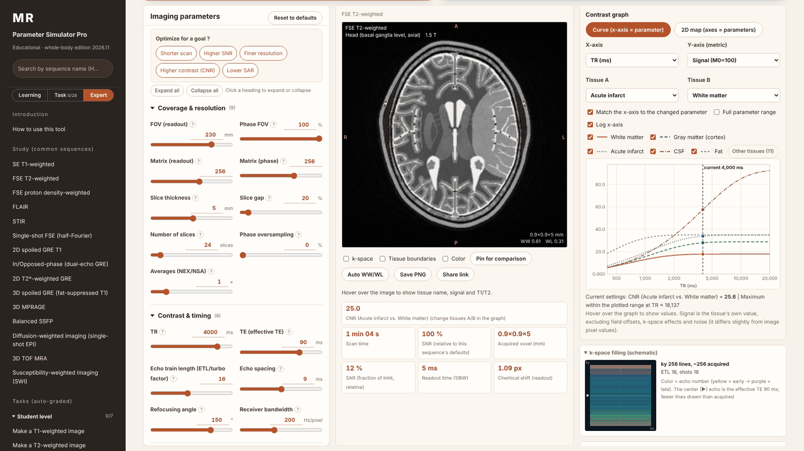
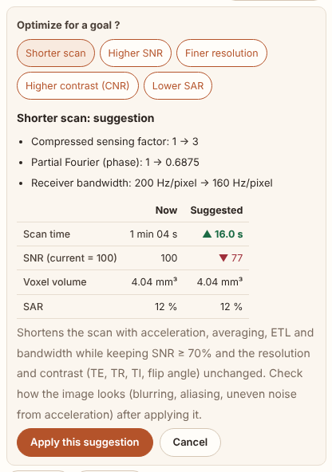
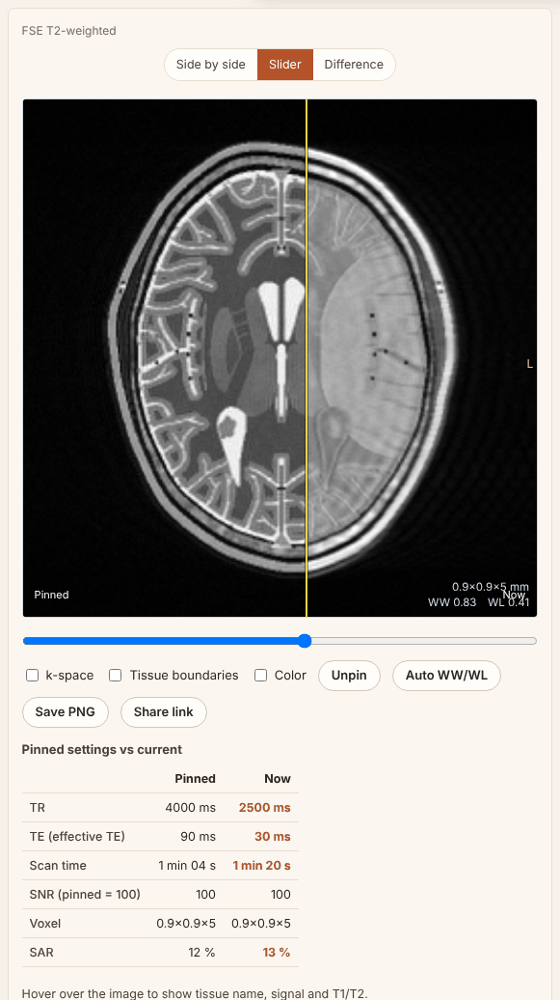
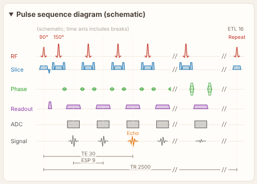
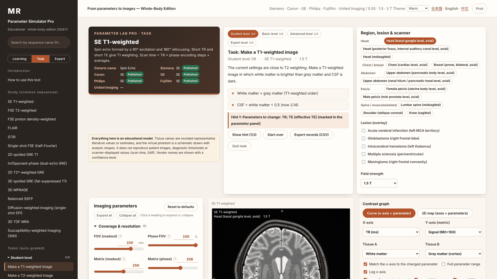
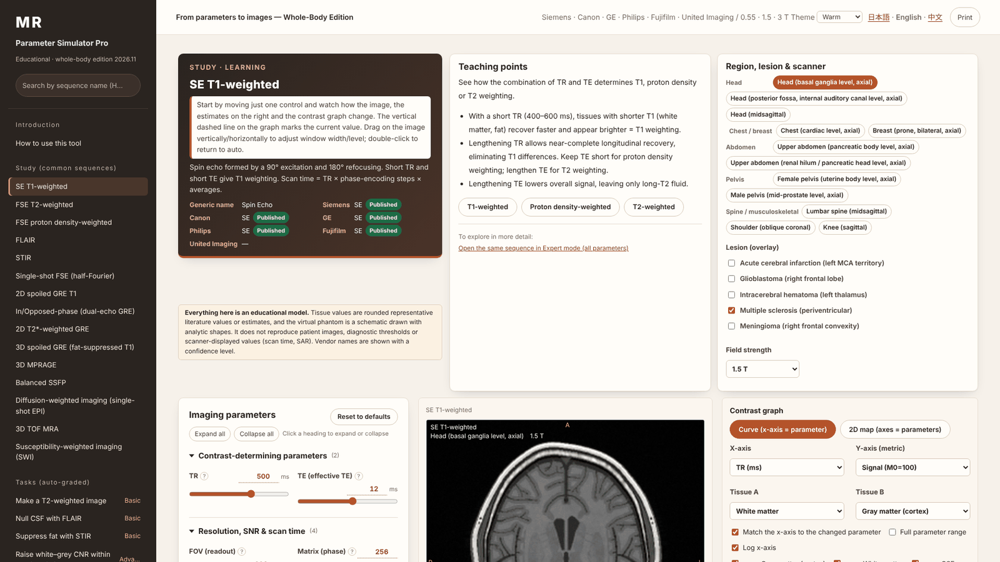
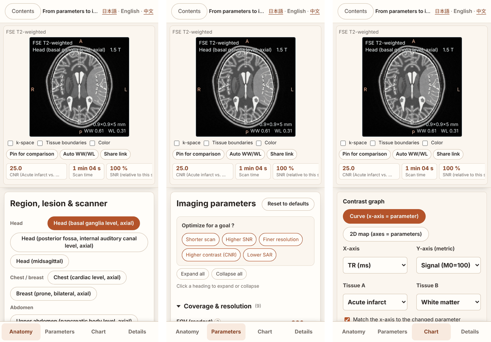

<h1 align="center">MRI Parameter Simulator Pro (whole-body edition)</h1>

<p align="center">
  Change acquisition parameters and watch the <strong>virtual-phantom image, scan time, SNR, SAR and tissue-contrast curves</strong> update instantly.<br>
  An educational MRI simulator in a single HTML file that runs offline.
</p>

<p align="center">
  <a href="https://ringnir.github.io/MRI-SIMULATOR-html/en.html"><strong>▶ Open in the browser</strong></a>
  　|　
  <a href="https://ringnir.github.io/MRI-SIMULATOR-html/en.html#learn"><strong>▶ Learning mode</strong></a>
  　|　
  <a href="https://ringnir.github.io/MRI-SIMULATOR-html/en.html#mission"><strong>▶ Try the tasks</strong></a>
  　|　
  <a href="en.html"><strong>HTML file (download)</strong></a>
  　|　
  <a href="README.md">日本語</a> · <a href="README.zh-CN.md">中文</a>
</p>

<p align="center">
  
</p>

> [!WARNING]
> **Educational approximation only. Do not use it for clinical decisions or scanner settings.** Tissue values are rounded literature values or estimates, and the virtual phantoms are analytic schematic drawings. Images, scan time, SNR and SAR do not reproduce any scanner's displayed values. This is not a medical device.

> [!NOTE]
> **Unofficial tool.** Not an official tool of Siemens Healthineers, GE HealthCare, Philips, Canon Medical Systems, Fujifilm or United Imaging Healthcare, and not commissioned, funded or reviewed by any vendor. Vendor sequence and feature names are shown only to indicate correspondence; they are trademarks or registered trademarks of their respective owners. Names can differ by software version and region — check the protocol names on your own scanner. Names that could not be verified are shown as "—".

> [!NOTE]
> **Disclosure:** The author belongs to an industry-academia collaborative chair at Nagoya University funded by Canon Inc. This tool was created by the author as an individual.

---

## Features

### Making images

| | |
|---|---|
| 🧠 **12 virtual phantoms** | Head (basal ganglia, posterior fossa / IAC, midsagittal), chest (heart), breast, upper abdomen (pancreatic body, renal hilum), pelvis (female, male), lumbar spine, shoulder, knee. 111 tissues. Switchable lesions (infarct, tumour, haemorrhage, demyelination, HCC, prostate cancer, bone-marrow oedema, meniscal tear, metal…) |
| 🎛️ **60 sequences** | SE/FSE/IR, GRE, SSFP, diffusion (DWI, DTI, readout-segmented, zoomed), MRA (TOF, PC, FBI, Time-SLIP, QISS, CE-MRA), cardiac (cine, LGE, MOLLI), Dixon/PDFF, MRCP, ASL, BOLD, DSC, UTE, MRE, MRS |
| 🔧 **Nearly every parameter** | TR, TE, TI, flip angle, ETL, echo spacing, bandwidth, matrix, FOV, slices; parallel imaging (GRAPPA/SENSE, CAIPIRINHA), SMS, compressed sensing, partial Fourier, deep-learning reconstruction; fat suppression; respiratory/ECG gating; contrast phases |
| 🖼️ **Artifacts** | Aliasing, motion and pulsation ghosts, chemical shift, susceptibility and metal, EPI distortion, banding, residual parallel-imaging aliasing |
| 🧮 **Three calculation levels** | Standard (fast approximation) / Precise (EPG, including FSE stimulated echoes and RF spoiling) / Bloch-equivalent (k-space computed directly from per-pixel magnetization; also EPI, 3D and flow). See [Calculation methods](#calculation-methods) |

### Understanding

| | |
|---|---|
| 📈 **Contrast chart** | Any parameter on the x-axis; signal, CNR, scan time or SAR on the y-axis, with the current value marked. 2D maps of two parameters |
| 📐 **Pulse sequence diagram** | RF, slice, phase, readout, ADC and signal timing drawn from the current parameters (TE, TR, ETL, TI, EPI…), for all 60 sequences |
| 🧩 **k-space filling** | Acquired lines, parallel-imaging undersampling, partial Fourier, FSE echo order, EPI trajectory, radial schemes |
| ⚖️ **Compare two conditions** | Compare a pinned image with the current one side by side, with a slider, or as a difference image, plus a table of changed parameters and time/SNR/SAR |
| 🏷️ **Vendor name table** | Sequence and option names for Siemens, Canon, GE, Philips, Fujifilm and United Imaging, with a confidence level (Published / Chart / Unverified) and sources. [Summary](#vendor-names) |

### Learning and teaching

| | |
|---|---|
| 🎯 **Optimize for a goal** | One-click buttons — Shorter scan, Higher SNR, Finer resolution, Higher contrast (CNR), Lower SAR — adjust parameters while respecting constraints (time, SNR, SAR, resolution). Review the before/after table, then apply or undo |
| 🏆 **Tasks with auto-grading** | 11 tasks such as *Make a T2-weighted image*, *Remove aliasing* and *Reduce metal artifacts*. Automatic pass/fail, graded hints, and CSV export of time, hints used and changes made (usable for teaching and education research) |
| 🎓 **Learning mode** | 15 common sequences with only the parameters that matter for learning, teaching points and presets |
| 🔗 **Share by link** | Region, sequence, parameters and chart settings are encoded in the URL; opening the link restores the same conditions (handy for slides or answering questions) |

### Ease of use

| | |
|---|---|
| 💻📱 **Desktop and phone** | Laid out to fit a Full HD (1920×1080) screen. On phones (~390 px wide) a fixed-size image and key figures (scan time, SNR…) stay pinned at the top, parameters are laid out in two columns so several can be adjusted at once, *Chart beside* puts a small contrast chart next to the image so you can watch it while adjusting (its x-axis follows the last parameter you moved), and tabs at the bottom switch between anatomy, parameters, chart and details |
| 🎨 **Themes** | Standard, Light, Dark (for reading rooms) and Warm (default), switchable at the top right |
| ♿ **Accessibility** | Chart lines differ by dash pattern as well as color, keyboard operation (arrow keys read chart values), text descriptions for images and charts, visible focus |
| 🌐 **Three languages, offline** | Japanese, English and Simplified Chinese. One HTML file; no installation or network needed, and nothing you enter is sent anywhere |

<table>
  <tr>
    <td align="center" valign="top"><br><sub>Optimize for a goal</sub></td>
    <td align="center" valign="top"><br><sub>Compare two conditions (slider)</sub></td>
    <td align="center" valign="top"><br><sub>Pulse sequence diagram</sub></td>
  </tr>
</table>

<table>
  <tr>
    <td align="center" valign="top"><br><sub>Tasks: graded automatically</sub></td>
    <td align="center" valign="top"><br><sub>Learning mode with teaching points</sub></td>
  </tr>
</table>

<p align="center">
  <br>
  <sub>Phone (iPhone width)</sub>
</p>

## Use

- **Online:** <https://ringnir.github.io/MRI-SIMULATOR-html/en.html>
- **As a file:** download [`en.html`](en.html) and open it in Chrome, Edge, Safari or Firefox.
- Japanese: [`index.html`](index.html); Simplified Chinese: [`zh.html`](zh.html). Switch at the top right.

| URL ending | Opens |
|---|---|
| `#expert` | Expert mode (all parameters, optimizer buttons, k-space) |
| `#learn` | Learning mode (15 sequences with teaching points) |
| `#mission` | Tasks (auto-graded) |
| `#expert&c=…` | A link made with *Share link* that restores its conditions |

**Switching modes.** Use the *Learning / Task / Expert* switch at the top of the sidebar (on phones, open it with the menu button at the top left). *Task* starts with the first task you have not solved yet.

**Basics.** Choose the anatomy, lesions and field strength at the top, then move the parameters on the left; the image in the middle and the chart on the right update. The dashed vertical line in the chart is the current value. Drag on the image to change window width/level; double-click to reset. Click a parameter group heading to open or close it.

**Optimizer.** The buttons above the parameters start from the current settings and propose changes that improve the chosen goal. To keep the type of weighting, TE, TR, TI and flip angle move only near their current values. Parallel imaging is limited to ×4, and compressed sensing to ×3 in 2D and ×8 in 3D. Suggestions come from an approximate model, so check the image (blurring, aliasing, uneven noise) before relying on them.

**Comparison.** Click *Pin for comparison*, then change parameters to compare the pinned image with the current one. Drag the divider (or use the arrow keys) in *Slider*; *Difference* shows brighter areas in orange and darker areas in blue.

**Task records.** Results (solved or not, time, hints, changes) are stored only in your browser (localStorage). *Export records (CSV)* downloads them.

## Calculation methods

| | Tissue signal | Image | Use |
|---|---|---|---|
| **Standard** | Closed-form signal equation per sequence (SE, IR, spoiled GRE, bSSFP steady state, numerical MPRAGE/MP2RAGE…) | A 1024² label image is sampled with the FOV and phase direction; echo-train decay, motion, partial Fourier and filters are applied in k-space; coil sensitivity, noise and g-factor are added | Everyday use (fast) |
| **Precise (EPG)** | Extended phase graphs: FSE stimulated echoes (refocusing < 180°, B1), IR/FSE steady state, RF spoiling (117°), FISP/PSIF, variable-flip 3D FSE | As standard | Effects of refocusing angle and B1 |
| **Bloch-equivalent** | Magnetization per pixel from EPG with per-pixel B1 and off-resonance | Each k-space sample is summed directly over pixels: magnetization × off-resonance phase × decay × intra-voxel dephasing × encoding phase. Supports SE, FSE, IR, single-shot FSE, 2D/3D GRE, 3D FSE, bSSFP (complex phase), EPI (DWI, DTI, BOLD, DSC) and through-plane flow (pulsation ghosts). Uses WebGPU when available | Chemical shift, distortion, T2* blurring and flow artifacts emerge from the signal equation |

- **Validation:** EPG agrees with a direct 720-isochromat Bloch simulation to within 1.53% ([`tests/epg_validate.js`](tests/epg_validate.js)). For EPI, the off-resonance shift is 4.37 px in Bloch-equivalent mode and 4.35 px in standard mode versus 4.50 px in theory ([`tests/bloch_epi_shift.js`](tests/bloch_epi_shift.js)). WebGPU and JavaScript results differ by ≤ 6×10⁻⁶ (relative).
- Everything runs in the browser (Web Worker). No external libraries.

Tissue values: Stanisz GJ, et al. MRM 2005 (PMID 16086319); de Bazelaire CMJ, et al. Radiology 2004 (PMID 14990831); Gold GE, et al. AJR 2004 (PMID 15269023); Wansapura JP, et al. JMRI 1999 (PMID 10232510); Rohrer M, et al. Invest Radiol 2005 (PMID 16230904). Some values are estimates (listed with sources under *Tissue parameters* in the app).

## Vendor names

Names are given for 60 sequences and 22 options with a confidence level: **Published** (confirmed in the vendor's own public documents), **Chart** (from a vendor comparison chart) or **Unverified**. The public build shows unverified names as "—". The full list and sources are on the *Sequence names by vendor* page in the app.

| | Siemens | Canon | GE | Philips | Fujifilm | United Imaging |
|---|---|---|---|---|---|---|
| Sequence names (of 60) confirmed in public documents | 55 | 46 | 50 | 40 | 43 | 40 |
| Option names (of 22) confirmed in public documents | 21 | 19 | 16 | 17 | 13 | 9 |

If a name is wrong or you have a newer document, please open an [issue](https://github.com/ringnir/MRI-SIMULATOR-html/issues/new/choose) (*Vendor name correction*).

## Development

```
src/            engine and UI
  tissues.js      tissue values        phantom.js, ph/*.js  virtual phantoms
  engine.js       signal, k-space, noise  seqs.js, seq/*.js  sequences
  epg.js          precise mode (EPG)   bloch.js             Bloch-equivalent mode (incl. WebGPU)
  vendors.js      vendor names, sources psd.js              pulse sequence diagrams
  missions.js     tasks                optim.js             optimizer
  state.js, meta.js, learn.js, ui.html, ui.js, themes.css
css/            styles
build.py        bundles src/ and css/ into one HTML file (--public, --lang=en|zh)
i18n/           English/Chinese translations (Japanese string → translation), applied at build time
tests/          Node tests
docs/           EXTENDING.md, PHANTOM_SPEC.md, images/
paper/          JOSS paper draft
```

```
python3 build.py en.html --public --lang=en   # English public build
python3 build.py zh.html --public --lang=zh   # Simplified Chinese
python3 build.py index.html --public          # Japanese

node tests/all.js              # all phantoms × all sequences × 1.5/3 T (a few minutes)
node tests/learn_chk.js        # learning-mode settings
node tests/optim_test.js       # optimizer never makes things worse
node tests/mission_chk.js      # tasks evaluate and are solvable
node tests/psd_test.js         # pulse sequence diagrams for every sequence
node tests/epg_validate.js     # EPG vs isochromat Bloch simulation
node tests/modes.js epg        # precise mode, all phantoms × all sequences
node tests/modes.js bloch      # Bloch-equivalent mode, all phantoms × all sequences (~10 min)
```

GitHub Actions ([`.github/workflows/ci.yml`](.github/workflows/ci.yml)) builds all three languages on every push (checking that the committed HTML is up to date and nothing is untranslated) and runs all the tests above.

## Extending

New sequences, techniques and phantoms are added by **dropping a file** into `src/seq/` (sequences, via `MS.addSeq`) or `src/ph/` (phantoms); the build picks them up automatically. Reuse an existing signal model in a few lines ([`src/seq/se_t2.js`](src/seq/se_t2.js)) or write a new one in `run` ([`src/seq/se_dual.js`](src/seq/se_dual.js)).

- Parameters: `MS.addParam`; learning items: `MS.addLearn`; categories: `MS.addCat`
- Tasks: `MS.addMission`; optimizer goals: `MS.addOptGoal`
- Translations: untranslated strings are listed in `i18n/missing_*.json` after a build

Details (in Japanese): [docs/EXTENDING.md](docs/EXTENDING.md).

## Contributing

For bug reports, vendor-name corrections and proposals, see [CONTRIBUTING.md](CONTRIBUTING.md).

## Citation

Please cite this software using the metadata in [CITATION.cff](CITATION.cff) ("Cite this repository" on GitHub gives APA and BibTeX). A DOI will be added after the first Zenodo release.

## License

[MIT License](LICENSE). No third-party code, fonts or images are included.
