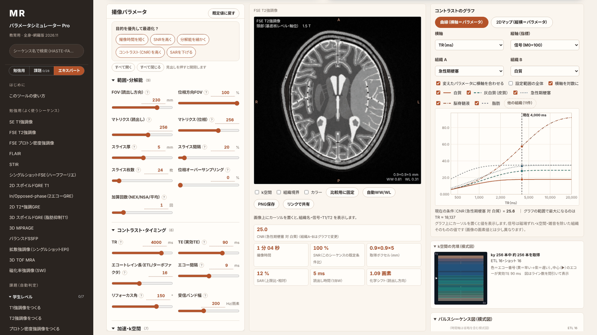
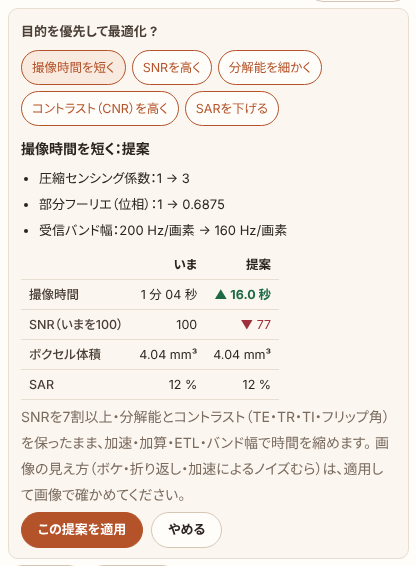
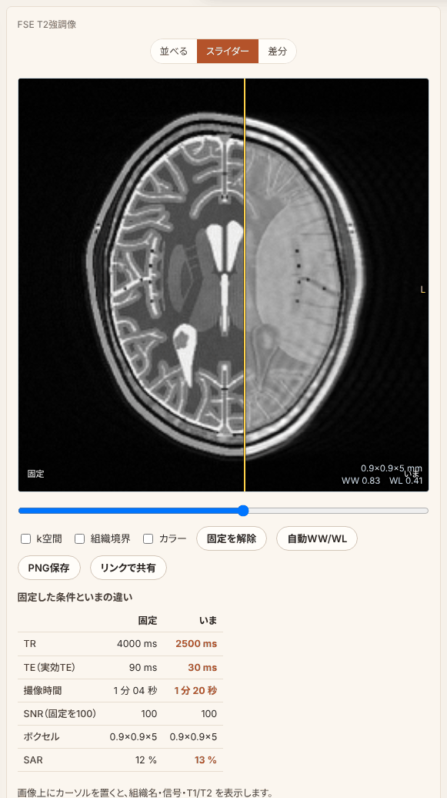
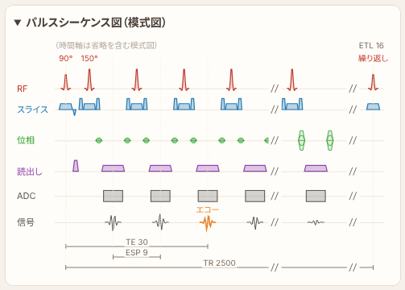
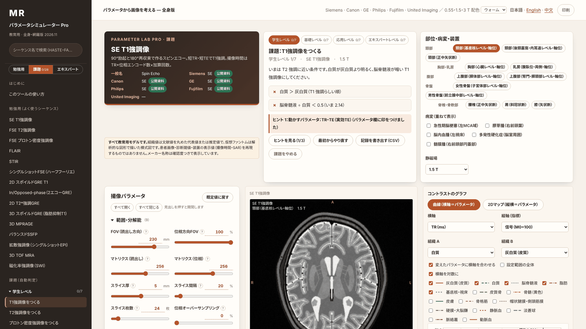
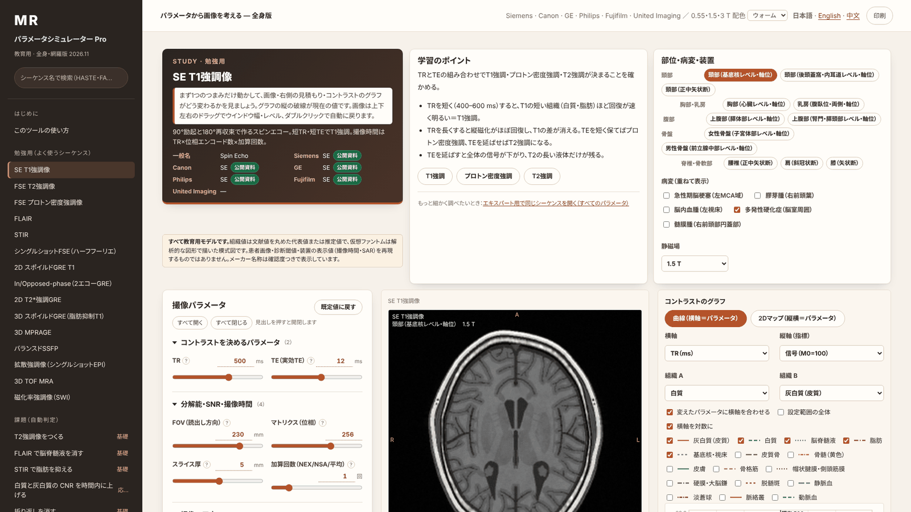
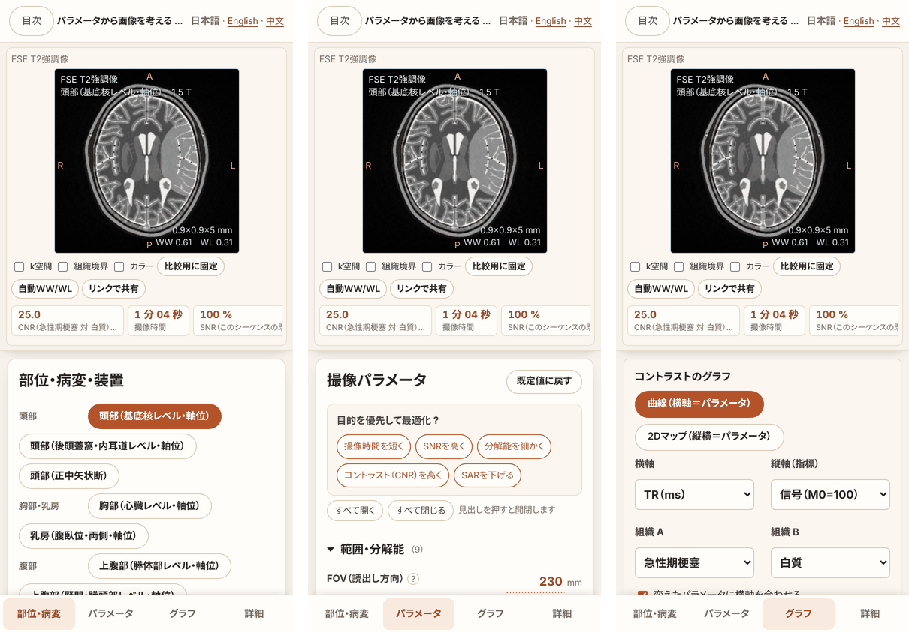

<h1 align="center">MRIパラメータシミュレーター Pro（全身・網羅版）</h1>

<p align="center">
  撮像パラメータを動かすと、<strong>仮想ファントムの画像・撮像時間・SNR・SAR・組織コントラストのグラフ</strong>がその場で変わる、<br>
  MRIの教育用シミュレーターです。HTMLファイル1つで、オフラインで動きます。
</p>

<p align="center">
  <a href="https://ringnir.github.io/MRI-SIMULATOR-html/"><strong>▶ ブラウザで開く</strong></a>
  　｜　
  <a href="https://ringnir.github.io/MRI-SIMULATOR-html/#learn"><strong>▶ 勉強用</strong></a>
  　｜　
  <a href="https://ringnir.github.io/MRI-SIMULATOR-html/#mission"><strong>▶ 課題に挑戦</strong></a>
  　｜　
  <a href="index.html"><strong>HTMLファイル（ダウンロード）</strong></a>
  　｜　
  <a href="README.en.md">English</a> · <a href="README.zh-CN.md">中文</a>
</p>

<p align="center">
  
</p>

> [!WARNING]
> **教育用の近似モデルです。診療・装置の設定には使わないでください。** 組織値は文献値を丸めた代表値・推定値、仮想ファントムは解析的な図形で描いた模式図です。画像・撮像時間・SNR・SAR は装置の表示値を再現するものではありません。医療機器ではありません。

> [!NOTE]
> **非公式のツールです。** Siemens Healthineers・GE HealthCare・Philips・Canon Medical Systems・Fujifilm・United Imaging Healthcare のいずれの公式ツールでもなく、いずれのメーカーからも依頼、資金提供、監修を受けていません。メーカーのシーケンス名・機能名は、名称の対応を示す目的で記載しています（各社の商標または登録商標です）。名称はソフトウェアのバージョン・地域で異なることがあるので、お使いの装置のプロトコル名で確認してください。裏付けのとれていない名称は「—」としています。

> [!NOTE]
> **利益相反の開示：** 作者は、名古屋大学のキヤノン株式会社との産学協同研究講座に所属しています。このツールは作者個人が作成したものです。

---

## できること

### 画像をつくる

|  | 内容 |
|---|---|
| 🧠 **仮想ファントム 12 種** | 頭部（基底核レベル・後頭蓋窩／内耳道・正中矢状）、胸部（心臓）、乳房、上腹部（膵体部・腎門）、骨盤（女性・男性）、腰椎、肩、膝。組織 111 種。病変（梗塞・腫瘍・出血・脱髄・HCC・前立腺癌・骨髄浮腫・半月板断裂・金属など）を重ねて表示 |
| 🎛️ **シーケンス 60 種** | SE／FSE／IR、GRE、SSFP、拡散（DWI・DTI・読出し分割・ズーム）、MRA（TOF・PC・FBI・Time-SLIP・QISS・造影）、心臓（シネ・LGE・MOLLI）、Dixon・PDFF、MRCP、ASL・BOLD・DSC、UTE、MRE、MRS など |
| 🔧 **ほぼ全パラメータ** | TR・TE・TI・フリップ角・ETL・エコー間隔・バンド幅・マトリクス・FOV・スライス、並列画像（GRAPPA／SENSE、CAIPIRINHA）・SMS・圧縮センシング・部分フーリエ・深層学習再構成、脂肪抑制、呼吸・心電図同期、造影の時相 |
| 🖼️ **アーチファクト** | 折り返し、動き・拍動のゴースト、化学シフト、磁化率・金属、EPI の歪み、バンディング、並列画像の残存折り返し |
| 🧮 **3 段階の計算方法** | 通常（速い近似）／精密計算（EPG：FSE の刺激エコー・RF スポイリングまで）／Bloch準拠モード（画素ごとの磁化から k 空間を直接計算。EPI・3D・流れにも対応）。くわしくは[計算方法](#計算方法) |

### 理解を助ける

|  | 内容 |
|---|---|
| 📈 **コントラストのグラフ** | 横軸に任意のパラメータ、縦軸に信号・CNR・撮像時間・SAR など。現在値に縦線。2つのパラメータの 2D マップも |
| 📐 **パルスシーケンス図** | RF・スライス・位相・読出し・ADC・信号の時間図を、いまのパラメータ（TE・TR・ETL・TI・EPI など）に合わせて描画。60 シーケンスすべてに対応 |
| 🧩 **k空間の充填** | 取得したライン・並列の間引き・部分フーリエ・FSE のエコー番号・EPI の軌跡・ラジアルの模式図 |
| ⚖️ **2条件の比較** | 「比較用に固定」した画像と、いまの画像を「並べる／スライダー／差分」で比較。違うパラメータと時間・SNR・SAR を表で表示 |
| 🏷️ **メーカー別の名称対応** | Siemens・Canon・GE・Philips・Fujifilm・United Imaging のシーケンス名・オプション名。確認度（公開資料／比較表／要確認）と出典つき。[一覧](#メーカー名称の対応) |

### 学ぶ・教える

|  | 内容 |
|---|---|
| 🎯 **目的を優先して最適化** | 「撮像時間を短く」「SNRを高く」「分解能を細かく」「コントラスト（CNR）を高く」「SARを下げる」のボタンで、制約（時間・SNR・SAR・分解能）を守りながらパラメータを自動調整。前後の比較を見てから適用・元に戻すができる |
| 🏆 **課題モード（自動判定）** | 学生・基礎・応用・エキスパートの 4 レベル × 7 題＝28 題（「T1強調像をつくる」から「3T 膝の高分解能 PD 脂肪抑制」「MPRAGE の CNR 最大化」まで）。うち 8 題（⚠）はアーチファクト対策：雑音・呼吸のゴースト・並列画像の雑音・折り返し・化学シフト・金属・EPI の歪み・重なったアーチファクトをわざと入れた画像から始め、まず原因を選択式で答え、次に条件を変えて減らす（画像の背景信号で判定）。条件を満たすと自動でクリア判定、最初のヒントで動かすパラメータを示して画面に印をつける段階的なヒント、所要時間・ヒント回数・変更回数を CSV で書き出し（授業や教育研究の評価に使える） |
| 🎓 **勉強用** | よく使う 15 シーケンスを、学習に必要なパラメータだけで。学習のポイントとプリセットつき |
| 🔗 **リンクで共有** | 部位・シーケンス・パラメータ・グラフの設定を URL に入れて共有。開くと同じ条件が再現される（授業スライドや質問への回答に） |

### 使いやすさ

|  | 内容 |
|---|---|
| 💻📱 **PC とスマートフォン** | フルHD（1920×1080）の画面で、見出し・部位の選択・画像・グラフが収まる配置。スマートフォン（幅 390 px 前後）では、固定サイズの画像と要点（撮像時間・SNR など）を上に固定し、パラメータは 2 列で一度に多く操作できる。「グラフを横に」で画像の右に小さなコントラストのグラフを出し、グラフを見ながらパラメータを動かせる（横軸は最後に動かしたパラメータに合わせて変わる）。下のタブで「部位・病変／パラメータ／グラフ／詳細」を切り替え |
| 🎨 **配色** | 標準・ライト・ダーク（読影室向け）・ウォーム（既定）を画面右上で切り替え |
| ♿ **アクセシビリティ** | グラフの線は色に加えて線種でも区別、キーボード操作（グラフは矢印キーで値を読み上げ）、画像・グラフに説明文、フォーカス表示 |
| 🌐 **3 言語・オフライン** | 日本語・英語・中国語（簡体字）。HTML ファイル 1 つで、インストールもネット接続も不要。入力した値はどこにも送信されない |

<table>
  <tr>
    <td align="center" valign="top"><br><sub>目的を優先して最適化</sub></td>
    <td align="center" valign="top"><br><sub>2条件の比較（スライダー）</sub></td>
    <td align="center" valign="top"><br><sub>パルスシーケンス図</sub></td>
  </tr>
</table>

<table>
  <tr>
    <td align="center" valign="top"><br><sub>課題モード：条件を満たすと自動でクリア判定</sub></td>
    <td align="center" valign="top"><br><sub>勉強用：学習のポイントつき</sub></td>
  </tr>
</table>

<p align="center">
  <br>
  <sub>スマートフォン（iPhone の幅）</sub>
</p>

## 使い方

- **URLから開く**：<https://ringnir.github.io/MRI-SIMULATOR-html/>
- **ファイルで使う**：[`index.html`](index.html) をダウンロードして、ブラウザ（Chrome・Edge・Safari・Firefox）で開くだけです。
- 英語版は [`en.html`](en.html)、中国語（簡体字）版は [`zh.html`](zh.html)。画面右上で切り替えられます。

| URL の末尾 | 開く画面 |
|---|---|
| `#expert` | エキスパート用（全パラメータ・最適化ボタン・k空間） |
| `#learn` | 勉強用（15 シーケンス、学習のポイントつき） |
| `#mission` | 課題（自動判定） |
| `#expert&c=…` | 「リンクで共有」で作った、条件つきのリンク |

**モードの切り替え**　サイドバー（スマホでは左上の「目次」）の一番上にある「勉強用／課題／エキスパート」で切り替えます。課題を選ぶと、まだクリアしていない最初の課題から始まります。課題カードの上のボタンでレベル（学生・基礎・応用・エキスパート）を選べ、各レベルのクリア数も表示されます。

**基本の操作**　画面の上の段で部位・病変・静磁場を選び、左のパラメータを動かすと、中央の画像と右のグラフが変わります。グラフの縦の破線が現在の値です。画像は上下左右のドラッグでウインドウ幅・レベル、ダブルクリックで自動に戻ります。パラメータの群は見出しを押すと開閉できます。

**最適化**　パラメータ欄の上のボタンを押すと、いまの条件から出発して目的が良くなる方向へパラメータを動かした提案が出ます。強調の種類が変わらないよう、TE・TR・TI・フリップ角は今の値の近くだけを動かします。並列画像は 4 倍まで、圧縮センシングは 2D で 3 倍・3D で 8 倍までに制限しています。提案は近似モデルの計算なので、画像の見え方（ぼけ・折り返し・ノイズむら）を確かめてから使ってください。

**比較**　「比較用に固定」を押してからパラメータを変えると、固定した画像と並べて見られます。「スライダー」は境目をドラッグ（または矢印キー）、「差分」はいまの方が明るい所を橙、暗い所を青で表示します。

**課題の記録**　課題の結果（クリアしたか・所要時間・ヒント回数・変更回数）はブラウザの中（localStorage）にだけ保存されます。「記録を書き出す（CSV）」で取り出せます。

## 計算方法

| | 組織の信号 | 画像 | 用途 |
|---|---|---|---|
| **通常** | シーケンスごとの信号式（SE、IR、スポイルド GRE、bSSFP の定常状態、MPRAGE／MP2RAGE の数値計算など） | 1024² のラベル画像を FOV・位相方向で標本化し、k 空間でエコートレインの減衰・動き・部分フーリエ・フィルタを加えて画像に戻し、コイル感度・雑音・g 因子を加える | ふだん使い（速い） |
| **精密計算（EPG）** | 拡張位相グラフ。FSE の刺激エコー（再収束角 <180°、B1 込み）、IR・FSE の定常状態、RF スポイリング（117°）、FISP／PSIF、3D FSE の可変再収束角 | 通常と同じ | 再収束角や B1 の影響を見る |
| **Bloch準拠モード** | 画素ごとの B1・磁場ずれで EPG により磁化を求める | k 空間の各サンプルを、画素ごとの磁化 × 磁場ずれの位相 × 減衰 × スライス内の位相分散 × エンコードの位相 の和として直接計算。SE・FSE・IR・シングルショット FSE・2D／3D GRE・3D FSE・bSSFP（複素位相）・EPI（DWI・DTI・BOLD・DSC）、面に垂直な流れ（拍動のゴースト）に対応。WebGPU があれば GPU で計算 | 化学シフト・歪み・T2* ぼけ・流れのアーチファクトを信号式から出す |

- **検証**：EPG は、isochromat 720 個で Bloch 方程式を直接解いた結果と比べて最大誤差 1.53%（[`tests/epg_validate.js`](tests/epg_validate.js)）。EPI の磁場ずれによる位置ずれは理論値 4.50 画素に対して Bloch準拠モード 4.37 画素・通常 4.35 画素（[`tests/bloch_epi_shift.js`](tests/bloch_epi_shift.js)）。WebGPU と JavaScript の計算結果の相対差は 6×10⁻⁶ 以下。
- 計算はすべてブラウザの中（Web Worker）で行います。外部ライブラリは使っていません。

組織値の出典：Stanisz GJ, et al. MRM 2005（PMID 16086319）、de Bazelaire CMJ, et al. Radiology 2004（PMID 14990831）、Gold GE, et al. AJR 2004（PMID 15269023）、Wansapura JP, et al. JMRI 1999（PMID 10232510）、Rohrer M, et al. Invest Radiol 2005（PMID 16230904）。一部は推定値です（画面の「組織パラメータ」に出典つきで一覧）。

## メーカー名称の対応

シーケンス 60 種とオプション 22 項目について、各社の名称を確認度つきで示しています。確認度は **公開資料**（メーカーの公開資料で名称を確認）・**比較表**（ベンダー比較表で確認）・**要確認** の 3 段階で、公開版では要確認の名称を「—」にしています。一覧と出典は画面の「シーケンス名の対応（メーカー別）」にあります。

| | Siemens | Canon | GE | Philips | Fujifilm | United Imaging |
|---|---|---|---|---|---|---|
| シーケンス名（60 種）のうち公開資料で確認 | 55 | 46 | 50 | 40 | 43 | 40 |
| オプション名（22 項目）のうち公開資料で確認 | 21 | 19 | 16 | 17 | 13 | 9 |

名称の誤りや、より新しい資料があれば [Issue](https://github.com/ringnir/MRI-SIMULATOR-html/issues/new/choose)（「メーカー名称の修正」）で教えてください。

## 開発

```
src/            エンジンと画面
  tissues.js      組織値            phantom.js, ph/*.js  仮想ファントム
  engine.js       信号・k空間・雑音  seqs.js, seq/*.js    シーケンス
  epg.js          精密計算（EPG）    bloch.js             Bloch準拠モード（WebGPU を含む）
  vendors.js      メーカー名称と出典  psd.js               パルスシーケンス図
  missions.js     課題              optim.js             最適化
  state.js, meta.js, learn.js, ui.html, ui.js, themes.css
css/            画面のスタイル
build.py        src/ と css/ を 1 つの HTML にまとめる（--public 公開版、--lang=en|zh 言語）
i18n/           英語・中国語の対訳（日本語の文字列 → 訳）。ビルド時にソースの文字列を置き換える
tests/          Node での試験
docs/           EXTENDING.md（拡張のしかた）、PHANTOM_SPEC.md（ファントムの仕様）、images/
paper/          JOSS 投稿用の原稿（草稿）
```

```
python3 build.py index.html --public            # 公開版（日本語）
python3 build.py en.html --public --lang=en     # 英語版
python3 build.py zh.html --public --lang=zh     # 中国語（簡体字）版

node tests/all.js              # 全ファントム×全シーケンス×1.5/3T（数分）
node tests/learn_chk.js        # 勉強用の設定の整合
node tests/optim_test.js       # 最適化が条件を悪くしないこと
node tests/mission_chk.js      # 課題の判定と、解けること
python3 tests/ui_missions.py index.html  # 画面で 28 題すべてが開始時は未達成・解を入れるとクリアになること（要 playwright）
node tests/psd_test.js         # パルスシーケンス図を全シーケンスで描けること
node tests/epg_validate.js     # EPG と Bloch 方程式（isochromat）の比較
node tests/modes.js epg        # 精密計算で全ファントム×全シーケンス
node tests/modes.js bloch      # Bloch準拠モードで全ファントム×全シーケンス（約 10 分）
```

GitHub Actions（[`.github/workflows/ci.yml`](.github/workflows/ci.yml)）で、push のたびに 3 言語のビルド（コミット済みの HTML が最新か・未訳の文字列がないか）と上の試験をすべて実行しています。

## 拡張する

新しいシーケンス・技術・ファントムは、**ファイルを1つ足すだけ**で追加できます。`src/seq/*.js`（シーケンス）と `src/ph/*.js`（ファントム）は、ビルド時に自動で読み込まれます。

- シーケンス：`MS.addSeq({...})`。既存の信号式を使うなら数行です（例 [`src/seq/se_t2.js`](src/seq/se_t2.js)）。新しい信号式も `run` に書けます（例 [`src/seq/se_dual.js`](src/seq/se_dual.js)）
- パラメータ：`MS.addParam([...])`　勉強用：`MS.addLearn({...})`　分類：`MS.addCat(id, 名前)`
- 課題：`MS.addMission({...})`　最適化の目的：`MS.addOptGoal({...})`
- 翻訳：ビルドで出る未訳の一覧（`i18n/missing_*.json`）に訳を足すだけ

詳しくは [docs/EXTENDING.md](docs/EXTENDING.md)。

## コントリビュート

不具合の報告・メーカー名称の修正・追加の提案は [CONTRIBUTING.md](CONTRIBUTING.md) を見てください。

## 引用 / Citation

引用には [CITATION.cff](CITATION.cff) の情報を使ってください（GitHub の「Cite this repository」から APA・BibTeX 形式で取得できます）。DOI は最初の Zenodo のリリース後に追記します。

## ライセンス

[MIT License](LICENSE)。第三者のソフトウェア・フォント・画像は含みません（文字は端末の游ゴシック・メイリオ等を使います）。
