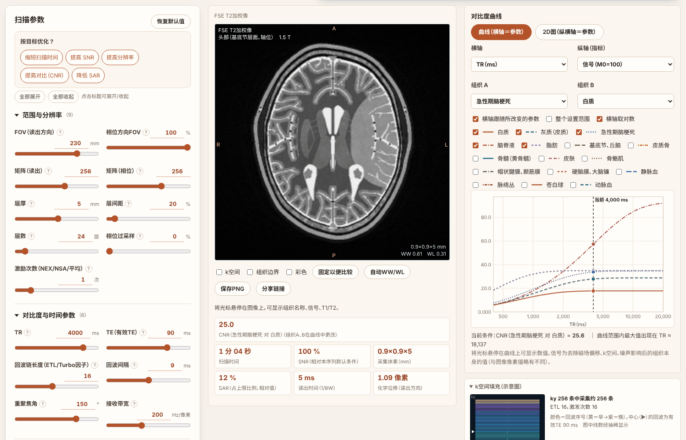
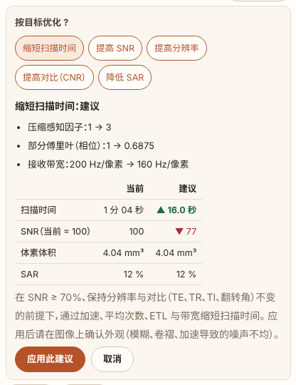
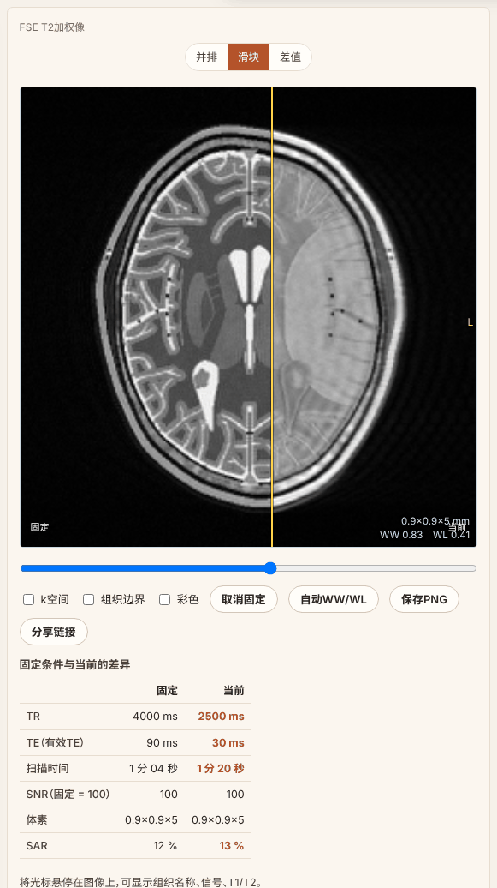
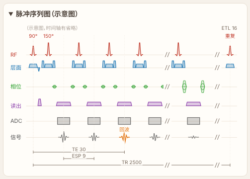
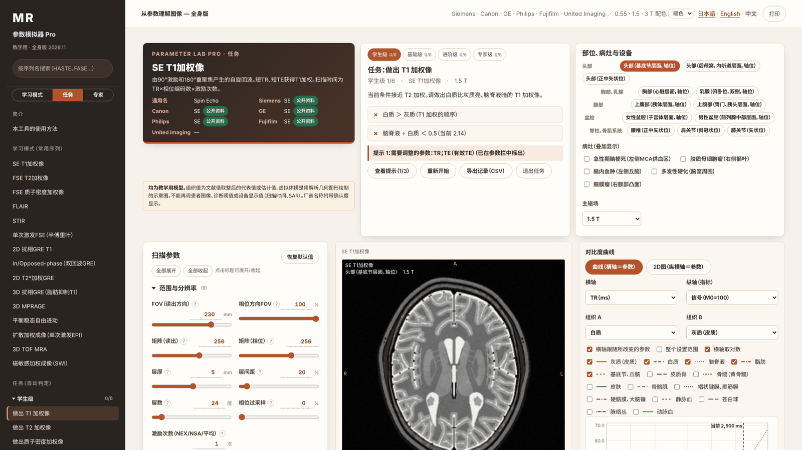
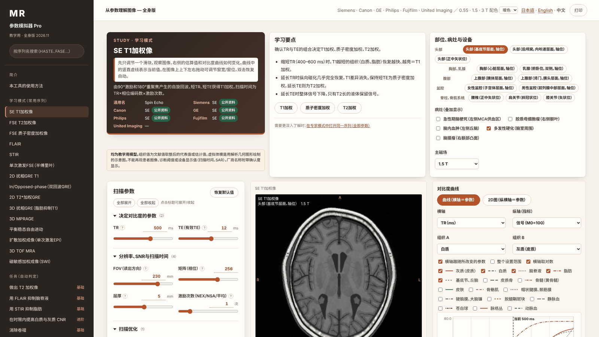
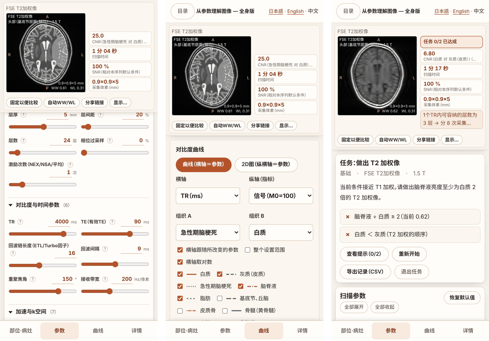

<h1 align="center">MRI 参数模拟器 Pro（全身版）</h1>

<p align="center">
  调整扫描参数，<strong>虚拟体模图像、扫描时间、SNR、SAR 和组织对比度曲线</strong>即时变化。<br>
  一个 HTML 文件即可离线运行的 MRI 教学模拟器。
</p>

<p align="center">
  <a href="https://ringnir.github.io/MRI-SIMULATOR-html/zh.html"><strong>▶ 在浏览器中打开</strong></a>
  　｜　
  <a href="https://ringnir.github.io/MRI-SIMULATOR-html/zh.html#learn"><strong>▶ 学习模式</strong></a>
  　｜　
  <a href="https://ringnir.github.io/MRI-SIMULATOR-html/zh.html#mission"><strong>▶ 挑战任务</strong></a>
  　｜　
  <a href="zh.html"><strong>HTML 文件（下载）</strong></a>
  　｜　
  <a href="README.md">日本語</a> · <a href="README.en.md">English</a>
</p>

<p align="center">
  
</p>

> [!WARNING]
> **仅为教学用近似模型，请勿用于临床诊断或设备参数设置。** 组织参数为文献值的取整代表值或估计值，虚拟体模为用解析图形绘制的示意图。图像、扫描时间、SNR、SAR 并不再现设备的显示值。本工具不是医疗器械。

> [!NOTE]
> **非官方工具。** 不是 Siemens Healthineers、GE HealthCare、Philips、Canon Medical Systems、Fujifilm、United Imaging Healthcare 任何一家的官方工具，也未受任何厂商的委托、资助或审阅。各厂商的序列名与功能名仅用于说明对应关系，为各公司的商标或注册商标。名称可能因软件版本和地区而不同，请以所用设备的协议名称为准。无法确认的名称显示为“—”。

> [!NOTE]
> **利益冲突声明：** 作者隶属于名古屋大学与佳能株式会社（Canon Inc.）共同设立的产学合作研究讲座。本工具由作者个人制作。

---

## 功能

### 生成图像

| | |
|---|---|
| 🧠 **12 种虚拟体模** | 头部（基底节层面、后颅窝/内听道、正中矢状）、胸部（心脏）、乳腺、上腹部（胰体、肾门）、盆腔（女性、男性）、腰椎、肩关节、膝关节。111 种组织。可叠加病灶（梗死、肿瘤、出血、脱髓鞘、HCC、前列腺癌、骨髓水肿、半月板撕裂、金属等） |
| 🎛️ **60 种序列** | SE/FSE/IR、GRE、SSFP、扩散（DWI、DTI、读出分段、小视野）、MRA（TOF、PC、FBI、Time-SLIP、QISS、增强 MRA）、心脏（电影、LGE、MOLLI）、Dixon/PDFF、MRCP、ASL、BOLD、DSC、UTE、MRE、MRS |
| 🔧 **几乎全部参数** | TR、TE、TI、翻转角、回波链长度、回波间隔、带宽、矩阵、FOV、层数；并行成像（GRAPPA/SENSE、CAIPIRINHA）、SMS、压缩感知、部分傅里叶、深度学习重建；脂肪抑制；呼吸/心电门控；增强时相 |
| 🖼️ **伪影** | 卷褶、运动与搏动伪影、化学位移、磁化率与金属、EPI 变形、条带伪影、并行成像残留卷褶 |
| 🧮 **三级计算方法** | 常规（快速近似）／精确计算（EPG，含 FSE 受激回波与射频扰相）／Bloch 等效模式（由逐像素磁化直接计算 k 空间，支持 EPI、3D 与流动）。详见[计算方法](#计算方法) |

### 帮助理解

| | |
|---|---|
| 📈 **对比度曲线** | 横轴可选任意参数，纵轴为信号、CNR、扫描时间或 SAR，并标出当前值；也可显示两个参数的二维图 |
| 📐 **脉冲序列图** | 按当前参数（TE、TR、ETL、TI、EPI 等）绘制 RF、层面、相位、读出、ADC 与信号的时序图，覆盖全部 60 种序列 |
| 🧩 **k 空间填充** | 采集线、并行成像欠采样、部分傅里叶、FSE 回波顺序、EPI 轨迹、放射状采集示意 |
| ⚖️ **两种条件对比** | 将“固定”的图像与当前图像并排、滑块或差值图对比，并以表格列出不同的参数与时间、SNR、SAR |
| 🏷️ **厂商名称对照** | Siemens、Canon、GE、Philips、Fujifilm、United Imaging 的序列名与选项名，附确认程度（公开资料／对比表／待确认）与出处。[汇总](#厂商名称对照) |

### 学习与教学

| | |
|---|---|
| 🎯 **按目标优化** | “缩短扫描时间”“提高 SNR”“提高分辨率”“提高对比（CNR）”“降低 SAR”按钮，在遵守约束（时间、SNR、SAR、分辨率）的前提下自动调整参数；先看前后对比表再应用，也可撤销 |
| 🏆 **任务模式（自动判定）** | “做出 T2 加权像”“消除卷褶”“减少金属伪影”等 11 道题。自动判定是否完成，分级提示，可导出用时、提示次数与修改次数（CSV），可用于教学与教育研究 |
| 🎓 **学习模式** | 15 种常用序列，只显示学习所需参数，附要点与预设 |
| 🔗 **链接分享** | 部位、序列、参数与图表设置写入 URL，打开即可重现相同条件（便于课件或答疑） |

### 易用性

| | |
|---|---|
| 💻📱 **电脑与手机** | 布局适配全高清（1920×1080）屏幕。手机（宽约 390 px）上固定尺寸的图像与要点（扫描时间、SNR 等）固定在上方，参数分两列排列、可同时调整多个，底部标签切换“部位·病灶／参数／曲线／详情” |
| 🎨 **配色** | 标准、浅色、深色（适合阅片室）、暖色（默认），可在右上角切换 |
| ♿ **无障碍** | 曲线除颜色外还以线型区分，支持键盘操作（方向键读取图表数值），图像与图表附文字说明，显示焦点 |
| 🌐 **三种语言、离线** | 日语、英语、简体中文。一个 HTML 文件，无需安装或联网，输入的数值不会发送到任何地方 |

<table>
  <tr>
    <td align="center" valign="top"><br><sub>按目标优化</sub></td>
    <td align="center" valign="top"><br><sub>两种条件对比（滑块）</sub></td>
    <td align="center" valign="top"><br><sub>脉冲序列图</sub></td>
  </tr>
</table>

<table>
  <tr>
    <td align="center" valign="top"><br><sub>任务模式：自动判定是否完成</sub></td>
    <td align="center" valign="top"><br><sub>学习模式：附学习要点</sub></td>
  </tr>
</table>

<p align="center">
  <br>
  <sub>手机（iPhone 宽度）</sub>
</p>

## 使用方法

- **在线打开：** <https://ringnir.github.io/MRI-SIMULATOR-html/zh.html>
- **作为文件使用：** 下载 [`zh.html`](zh.html)，用 Chrome、Edge、Safari 或 Firefox 打开即可。
- 日语版 [`index.html`](index.html)，英语版 [`en.html`](en.html)，可在右上角切换。

| 网址末尾 | 打开的界面 |
|---|---|
| `#expert` | 专家模式（全部参数、优化按钮、k 空间） |
| `#learn` | 学习模式（15 种序列，附学习要点） |
| `#mission` | 任务（自动判定） |
| `#expert&c=…` | 用“分享链接”生成、可重现条件的链接 |

**切换模式**　在侧栏（手机上点左上角的菜单按钮）最上方的“学习模式／任务／专家”之间切换。选择“任务”会从第一个尚未完成的任务开始。

**基本操作**　在上方选择部位、病灶和磁场强度，再调整左侧参数，中间的图像和右侧的曲线随之变化。曲线中的竖虚线表示当前值。在图像上拖动可调整窗宽/窗位，双击恢复自动。点击参数组标题可展开或收起。

**优化**　点击参数上方的按钮，会从当前条件出发，给出使所选目标变好的参数建议。为保持加权类型，TE、TR、TI 与翻转角只在当前值附近调整。并行成像最多 4 倍，压缩感知在 2D 中最多 3 倍、3D 中最多 8 倍。建议来自近似模型，请先在图像上确认外观（模糊、卷褶、噪声不均）再使用。

**对比**　点击“固定以便比较”后修改参数，即可与固定的图像对比。“滑块”可拖动分界线（或用方向键），“差值”以橙色显示当前更亮处、蓝色显示更暗处。

**任务记录**　结果（是否完成、用时、提示次数、修改次数）只保存在浏览器内（localStorage），可用“导出记录（CSV）”取出。

## 计算方法

| | 组织信号 | 图像 | 用途 |
|---|---|---|---|
| **常规** | 各序列的信号公式（SE、IR、扰相 GRE、bSSFP 稳态、MPRAGE/MP2RAGE 数值计算等） | 将 1024² 标签图像按 FOV 与相位方向采样，在 k 空间加入回波链衰减、运动、部分傅里叶与滤波后重建，再加入线圈灵敏度、噪声与 g 因子 | 日常使用（快速） |
| **精确计算（EPG）** | 扩展相位图：FSE 受激回波（重聚焦角 <180°、含 B1）、IR/FSE 稳态、射频扰相（117°）、FISP/PSIF、3D FSE 可变翻转角 | 同常规 | 观察重聚焦角与 B1 的影响 |
| **Bloch 等效模式** | 用逐像素 B1 与频率偏移经 EPG 求磁化 | 每个 k 空间采样点直接对像素求和：磁化 × 频偏相位 × 衰减 × 体素内相位离散 × 编码相位。支持 SE、FSE、IR、单次激发 FSE、2D/3D GRE、3D FSE、bSSFP（复数相位）、EPI（DWI、DTI、BOLD、DSC）与垂直于层面的流动（搏动伪影）。有 WebGPU 时使用 GPU 计算 | 由信号方程直接得到化学位移、变形、T2* 模糊与流动伪影 |

- **验证：** EPG 与 720 个 isochromat 直接求解 Bloch 方程的结果相比，最大误差 1.53%（[`tests/epg_validate.js`](tests/epg_validate.js)）。EPI 的频偏位移理论值为 4.50 像素，Bloch 等效模式为 4.37 像素、常规为 4.35 像素（[`tests/bloch_epi_shift.js`](tests/bloch_epi_shift.js)）。WebGPU 与 JavaScript 结果的相对差 ≤ 6×10⁻⁶。
- 全部计算在浏览器内（Web Worker）完成，不使用外部库。

组织参数出处：Stanisz GJ, et al. MRM 2005（PMID 16086319）；de Bazelaire CMJ, et al. Radiology 2004（PMID 14990831）；Gold GE, et al. AJR 2004（PMID 15269023）；Wansapura JP, et al. JMRI 1999（PMID 10232510）；Rohrer M, et al. Invest Radiol 2005（PMID 16230904）。部分为估计值（在界面的“组织参数”中附出处列出）。

## 厂商名称对照

对 60 种序列与 22 项选项列出各厂商名称及确认程度：**公开资料**（在厂商公开文件中确认）、**对比表**（来自厂商对比表）、**待确认**。公开版中待确认的名称显示为“—”。完整列表与出处见界面中的“各厂商序列名称对照”。

| | Siemens | Canon | GE | Philips | Fujifilm | United Imaging |
|---|---|---|---|---|---|---|
| 序列名（共 60）中已由公开资料确认 | 55 | 46 | 50 | 40 | 43 | 40 |
| 选项名（共 22）中已由公开资料确认 | 21 | 19 | 16 | 17 | 13 | 9 |

如发现名称有误或有更新的资料，欢迎提交 [Issue](https://github.com/ringnir/MRI-SIMULATOR-html/issues/new/choose)（“Vendor name correction”）。

## 开发

源代码结构、构建与测试方法见英文版 [README.en.md](README.en.md#development)。扩展方法（新增序列、参数、体模、任务、优化目标）见 [docs/EXTENDING.md](docs/EXTENDING.md)（日文）。

```
python3 build.py zh.html --public --lang=zh   # 构建简体中文公开版
node tests/all.js                              # 全部体模 × 全部序列 × 1.5/3 T
```

## 贡献

问题报告、厂商名称修正与功能建议请参阅 [CONTRIBUTING.md](CONTRIBUTING.md)。

## 引用

请使用 [CITATION.cff](CITATION.cff) 中的信息引用本软件（在 GitHub 上点击“Cite this repository”可获取 APA 与 BibTeX 格式）。首次在 Zenodo 发布后将补充 DOI。

## 许可

[MIT License](LICENSE)。不包含第三方代码、字体或图像。
